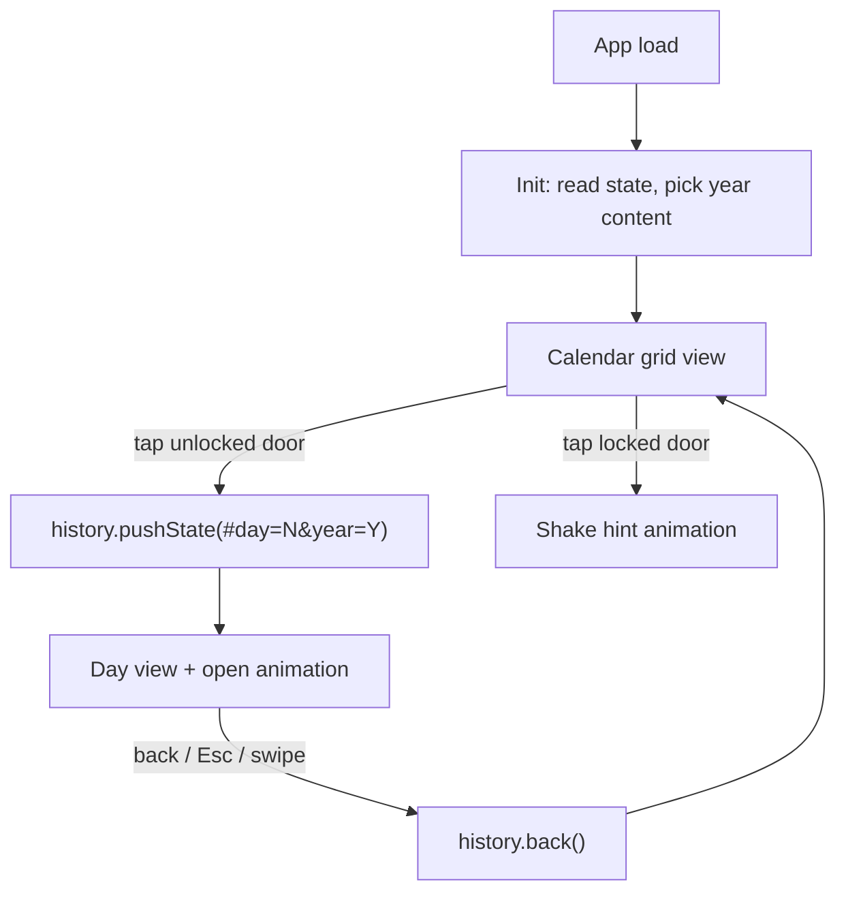

# Song Adventskalender v2 – Implementation Plan

> Status: planned · Branch: `v2` · Based on the [v2 concept](song-adventskalender-v2-konzept.md)

A full rewrite of the v1 Song-Adventskalender: a fully static, single-page advent
calendar that reveals one feel-good song and a positive-lifestyle text per December
day. 100 % client-side, GitHub Pages hosting, all state on the device.

---

## 0. Goals & non-goals

**Goals**
- 100 % client-side, deployable on GitHub Pages (static hosting only)
- All state persists on the device (localStorage)
- Multi-year capable by design: content files, localStorage state, and deep links are all year-scoped; past seasons stay in the repo and on device, so an archive view can be added later without migration
- Content-type extensible: a day is a generic `type` + `payload` envelope with a per-type registry, so future door types (image, text-only, …) need no changes to grid, router, state, or unlock logic
- New visual design with door-open animations
- Faster and more robust than v1: no full page loads, no year constant to edit by
  hand, build-time validated content

**Non-goals**
- Accounts, sync across devices, or any backend
- Hosting the songs themselves (YouTube/Spotify embeds only, as in v1)
- Archive browsing of past years in the v2 UI — no archive view or year picker
  ships. As a hidden feature instead: year-scoped deep links reach past seasons,
  the unlock rule lifts once a season has ended, and past content files and
  state keys are never auto-deleted. Nothing needs rebuilding if an archive view
  is added later

## 1. Tech stack

| Layer | Choice | Rationale |
| --- | --- | --- |
| Language | TypeScript | Catches content/state bugs at build time (v1's `CURRENT_YEAR` bug class) |
| Build | Vite | Dev server with HMR, minified static build output, zero-config static assets |
| UI | Vanilla TS, no framework | Two views, tiny state; whole app ships in a few kB |
| Styling | Modern CSS (custom properties, `@media (prefers-reduced-motion)`) | No CSS framework needed |
| Routing | History API (`pushState` + `popstate`) | SPA navigation that respects mobile back gestures |
| State | localStorage | On-device persistence as required |
| Tests | Vitest for logic (dates, shuffle, storage) | Cheap insurance for a once-a-year app |
| Deploy | GitHub Actions → GitHub Pages | `vite build` output published to Pages on every push to `main` |

**Shipped JS budget: < 15 kB gzip** including app logic and content data.

## 2. Architecture

Single page, two logical views rendered from one `index.html`:



**Project structure**

```
src/
  main.ts            # entry: init state, render grid
  views/
    calendar.ts      # grid renderer + door states
    day.ts           # day view renderer
  core/
    router.ts        # pushState/popstate wrapper, hash deep links
    state.ts         # localStorage store, one key per season
    content.ts       # loads + validates year content
    unlock.ts        # date logic (which day is open today)
  content/
    2026.json        # this season's 24 entries
  styles/
    main.css
public/
  img/               # door artwork (woff2 fonts, WebP/AVIF + fallbacks)
```

## 3. Content model

The calendar is content-type-agnostic. Bundled static JSON per year, imported at
build time (no runtime fetch, no first-load database copy like v1). Each day is a
thin envelope of `day` + `type`; all type-specific data lives in `payload`:

```json
{
  "schemaVersion": 2,
  "year": 2026,
  "entries": [
    {
      "day": 1,
      "type": "song",
      "payload": {
        "title": "Running on Air",
        "artist": "Nathan Trent",
        "quote": "…",
        "text": "…",
        "spotifyId": "1WpQu8U3quBeGnhpZn0r7N",
        "youtubeId": "SpPM1V3dqZE"
      }
    },
    {
      "day": 5,
      "type": "text",
      "payload": { "quote": "…", "text": "…" }
    }
  ]
}
```

**Entry-type registry** (`src/entries/registry.ts`): every door type registers

- `schema` — build-time payload validation (zod)
- `renderDay()` — renders the day-view body
- `doorPreview()` — what the opened door tile shows (title + artist / caption / …)
- optional `preload()` — lazy asset handling (e.g. embed iframes)

- TypeScript discriminated union `CalendarEntry = SongEntry | TextEntry |
  ImageEntry | …`; an exhaustiveness check in the registry forces every renderer
  to handle every registered type at compile time
- Built-in at launch: `song` (quote + text + lazy YouTube/Spotify embeds) and
  `text` (the rename of v1's `impuls`: quote + text only). v1's `impuls` entries
  map 1:1 to `text`
- **Adding a future type** — e.g. `image` with payload `{ src, alt, caption? }` —
  is one new file (schema + renderer) plus one registry line. Grid, router,
  state, and unlock logic never change; invalid payloads fail the build, so an
  unknown shape can never reach production
- **Build-time validation**: a small script asserts exactly 24 entries, days
  1–24 unique, `year` matches the filename, the `schemaVersion` is one the app
  knows, every payload validates against its
  type's schema, and that the active year file exists — the build fails
  otherwise. This structurally prevents v1's "2025 constant but only 2023 data"
  crash class
- Active season resolved by `core/season.ts` from device date (December =
  current year; outside December the season logic decides), with a `config.ts`
  override for testing. Past year files stay in the repo — nothing is deleted
  when a season ends

## 4. State management (on-device)

One JSON object per season, stored under `sak.{year}` — `sak` stands for
Song-Adventskalender and is a constant namespace prefix to avoid collisions with
other data on the same origin (v1 used ~50 scattered keys):

```json
{
  "version": 2,
  "year": 2026,
  "seed": 812394,
  "openedDays": [1, 4, 5],
  "lastVisit": "2026-12-05"
}
```

- **Year-scoped state**: each season gets its own key (`sak.2026`,
  `sak.2027`, …). Switching years never touches another season's progress, and
  finished seasons' keys are never auto-deleted — kept for revisiting old
  calendars with zero migration
- **Versioned state schema**: the state carries a `version` field. If a future
  build reads an unknown/older `version`, it falls back to a safe re-init that
  preserves `openedDays` where possible. The per-season key makes even a full
  discard cheap — only one season's progress is at risk, and only after
  December. v1 keys are never read: the app treats itself as a new install
- **Seeded shuffle instead of stored songs**: on first visit of a season a random
  32-bit `seed` is generated. A seeded PRNG (mulberry32) derives a deterministic
  permutation of the 24 entries — reproducible from ~10 characters, so a partial
  localStorage wipe or future migration can never silently reshuffle already-opened
  days (v1's `isFirstLoad` bug class). State references entries only by `day`
  index — never by title/id — so the same state logic works for any content shape
  and any year
- Only season keys are written; "reset the calendar" is a one-key operation.

**Unlock rule:** door N opens on December N of the season year (local device
time). Outside December: friendly "see you in December" teaser. Hidden dev flag
(URL param `?dev=all`, no hostname sniffing like v1) unlocks all doors for
testing. Clock manipulation is accepted — feel-good app, not DRM.

**Past seasons:** door N of season Y is openable from December N of Y onward, so
any season that has ended is fully unlocked. Combined with year-scoped deep
links, revisiting old calendars is a hidden feature: `#day=7&year=2024` works
forever, there is no archive UI, and old content files and state keys are never
automatically deleted.

## 5. UX & design direction

**Calendar grid**
- Three door states: **locked** (dimmed) · **today & unopened** (highlighted,
  gentle pulse/sparkle — the daily hook) · **opened** (type-specific preview via
  the entry type's `doorPreview()`, e.g. title + artist)
- Tap locked → shake animation + "Abwarten und Tee trinken…" hint
- Responsive: 2 columns on small phones up to 6–8 on desktop

**Day view**
- Day view is a type-agnostic **shell** (open animation, back affordances, deep
  links); the body is rendered by the entry type's `renderDay()`. The hero layout
  (large serif quote first, then title/artist, motivational text, then embeds) is
  the `song`/`text` variant — a future `image` type plugs in without touching the
  shell
- Embeds (`song` type) lazy-load via the type's `preload()`: iframes load on
  scroll so text paints instantly
- All back affordances funnel through one `history.back()` path: top-left ✕,
  Esc key, mobile swipe
- Deep links `#day=N&year=2026` open the day view directly — shareable,
  refresh-safe, guarded by the unlock rule. The `year` param is optional and
  defaults to the active season; day-one year-scoping means a future archive
  view just reads it

**Visual:** warm winter palette, self-hosted woff2 font subsets (Playfair
Display, Varta) instead of full TTFs, per-door artwork, subtle CSS
snow/particles, 3D door-flip on open. All motion disabled under
`prefers-reduced-motion`.

## 6. Performance & quality

- Single HTML file, one CSS + one JS bundle, hashed assets, long-term caching
- Fonts as woff2 subsets; images WebP/AVIF with fallback, lazy-loaded
- No analytics (optional, privacy-friendly, off by default)
- Vitest for `unlock.ts`, `season.ts`, seeded shuffle, state-version
  migration, and per-type payload schemas; deterministic
  permutation tests with fixed seeds

## 7. Deployment

- GitHub Actions: push to `main` → `npm ci && npm run build` → publish `dist/` to Pages
- New season = add `content/{year}.json` (24 entries) + artwork + tag release —
  no code changes (a debuting entry type is one registry entry + one renderer
  file)

## 8. Migration from v1

- Fresh state: v1 keys are incompatible; app treats itself as new install
- **Reuse from v1**: content format & texts (`songs.json` 2023 entries ported;
  `impuls` entries become the new `text` type), fonts (subset to woff2), PWA
  manifest/icons, the general unlock philosophy
- Old repo's `img/` artwork carried over or replaced in the new design

## 9. Open decisions (§10 of the concept)

1. "December 25+" special final door (Christmas bonus) beyond the 24? → TBD
2. PWA install (manifest + service worker for offline): now or later? → TBD
3. Keep the `impuls` (text-only) day type? → **Resolved**: kept, renamed to
   `text`; the entry-type registry admits arbitrary future types (`image`, …).
   Which one ships first after `song`/`text` is still open
4. Door artwork: reuse v1 photos, commission new, or AI-generated? → TBD
