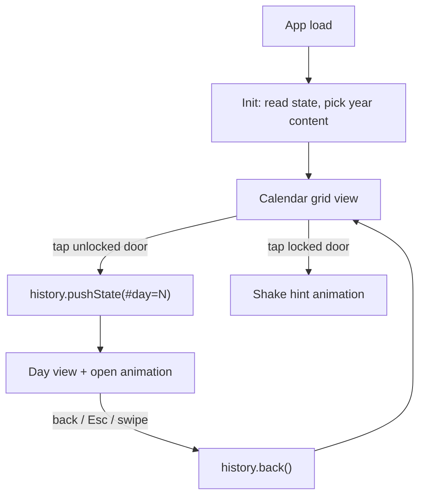

# Song Adventskalender v2 – Implementation Plan

> Status: planned · Branch: `v2` · Based on the [v2 concept](song-adventskalender-v2-konzept.md)

A full rewrite of the v1 Song-Adventskalender: a fully static, single-page advent
calendar that reveals one feel-good song and a positive-lifestyle text per December
day. 100 % client-side, GitHub Pages hosting, all state on the device.

---

## 0. Goals & non-goals

**Goals**
- 100 % client-side, deployable on GitHub Pages (static hosting only)
- All state persists on the device (localStorage)
- Multi-year capable: each season is just a new content file
- New visual design with door-open animations
- Faster and more robust than v1: no full page loads, no year constant to edit by
  hand, build-time validated content

**Non-goals**
- Accounts, sync across devices, or any backend
- Hosting the songs themselves (YouTube/Spotify embeds only, as in v1)
- Archive browsing of past years

## 1. Tech stack

| Layer | Choice | Rationale |
| --- | --- | --- |
| Language | TypeScript | Catches content/state bugs at build time (v1's `CURRENT_YEAR` bug class) |
| Build | Vite | Dev server with HMR, minified static build output, zero-config static assets |
| UI | Vanilla TS, no framework | Two views, tiny state; whole app ships in a few kB |
| Styling | Modern CSS (custom properties, `@media (prefers-reduced-motion)`) | No CSS framework needed |
| Routing | History API (`pushState` + `popstate`) | SPA navigation that respects mobile back gestures |
| State | localStorage | On-device persistence as required |
| Tests | Vitest for logic (dates, shuffle, storage) | Cheap insurance for a once-a-year app |
| Deploy | GitHub Actions → GitHub Pages | `vite build` output published to Pages on every push to `main` |

**Shipped JS budget: < 15 kB gzip** including app logic and content data.

## 2. Architecture

Single page, two logical views rendered from one `index.html`:



**Project structure**

```
src/
  main.ts            # entry: init state, render grid
  views/
    calendar.ts      # grid renderer + door states
    day.ts           # day view renderer
  core/
    router.ts        # pushState/popstate wrapper, hash deep links
    state.ts         # localStorage store (versioned schema)
    content.ts       # loads + validates year content
    unlock.ts        # date logic (which day is open today)
  content/
    2026.json        # this season's 24 entries
  styles/
    main.css
public/
  img/               # door artwork (woff2 fonts, WebP/AVIF + fallbacks)
```

## 3. Content model

Bundled static JSON per year, imported at build time (no runtime fetch, no
first-load database copy like v1):

```json
{
  "year": 2026,
  "entries": [
    {
      "day": 1,
      "type": "song",
      "title": "Running on Air",
      "artist": "Nathan Trent",
      "quote": "…",
      "text": "…",
      "spotifyId": "1WpQu8U3quBeGnhpZn0r7N",
      "youtubeId": "SpPM1V3dqZE"
    }
  ]
}
```

- `type` stays extensible: `song` (full treatment) and `impuls` (text-only day, embeds hidden)
- **Build-time validation**: a small script asserts exactly 24 entries, days 1–24
  unique, all required fields present, and that the active year file exists — the
  build fails otherwise. This structurally prevents v1's
  "2025 constant but only 2023 data" crash class.
- Active year derived from device date (December = current year; outside December
  the season logic decides), with a `config.ts` override for testing.

## 4. State management (on-device)

Single localStorage key `sak.state`, one versioned JSON object (v1 used ~50
scattered keys):

```json
{
  "version": 2,
  "year": 2026,
  "seed": 812394,
  "openedDays": [1, 4, 5],
  "lastVisit": "2026-12-05"
}
```

- **Seeded shuffle instead of stored songs**: on first visit of a season a random
  32-bit `seed` is generated. A seeded PRNG (mulberry32) derives a deterministic
  permutation of the 24 entries — reproducible from ~10 characters, so a partial
  localStorage wipe or future migration can never silently reshuffle already-opened
  days (v1's `isFirstLoad` bug class).
- Migration: unknown/older `version` → safe re-init that preserves `openedDays`.
- Only this one key is written; "reset the calendar" is a one-key operation.

**Unlock rule:** door N opens on December N of the season year (local device
time). Outside December: friendly "see you in December" teaser. Hidden dev flag
(URL param `?dev=all`, no hostname sniffing like v1) unlocks all doors for
testing. Clock manipulation is accepted — feel-good app, not DRM.

## 5. UX & design direction

**Calendar grid**
- Three door states: **locked** (dimmed) · **today & unopened** (highlighted,
  gentle pulse/sparkle — the daily hook) · **opened** (title + artist shown)
- Tap locked → shake animation + "Abwarten und Tee trinken…" hint
- Responsive: 2 columns on small phones up to 6–8 on desktop

**Day view**
- Hero layout: large serif quote first (emotional anchor), then title/artist,
  motivational text, then embeds
- YouTube/Spotify iframes lazy-load on scroll so text paints instantly
- All back affordances funnel through one `history.back()` path: top-left ✕,
  Esc key, mobile swipe
- Deep links `#day=N` open the day view directly — shareable, refresh-safe,
  guarded by the unlock rule

**Visual:** warm winter palette, self-hosted woff2 font subsets (Playfair
Display, Varta) instead of full TTFs, per-door artwork, subtle CSS
snow/particles, 3D door-flip on open. All motion disabled under
`prefers-reduced-motion`.

## 6. Performance & quality

- Single HTML file, one CSS + one JS bundle, hashed assets, long-term caching
- Fonts as woff2 subsets; images WebP/AVIF with fallback, lazy-loaded
- No analytics (optional, privacy-friendly, off by default)
- Vitest for `unlock.ts`, seeded shuffle, state migration; deterministic
  permutation tests with fixed seeds

## 7. Deployment

- GitHub Actions: push to `main` → `npm ci && npm run build` → publish `dist/` to Pages
- New season = add `content/{year}.json` (24 entries) + artwork + tag release — no code changes

## 8. Migration from v1

- Fresh state: v1 keys are incompatible; app treats itself as new install
- **Reuse from v1**: content format & texts (`songs.json` 2023 entries ported),
  fonts (subset to woff2), PWA manifest/icons, the general unlock philosophy
- Old repo's `img/` artwork carried over or replaced in the new design

## 9. Open decisions (§10 of the concept)

1. "December 25+" special final door (Christmas bonus) beyond the 24? → TBD
2. PWA install (manifest + service worker for offline): now or later? → TBD
3. Keep the `impuls` (text-only) day type? → TBD
4. Door artwork: reuse v1 photos, commission new, or AI-generated? → TBD
