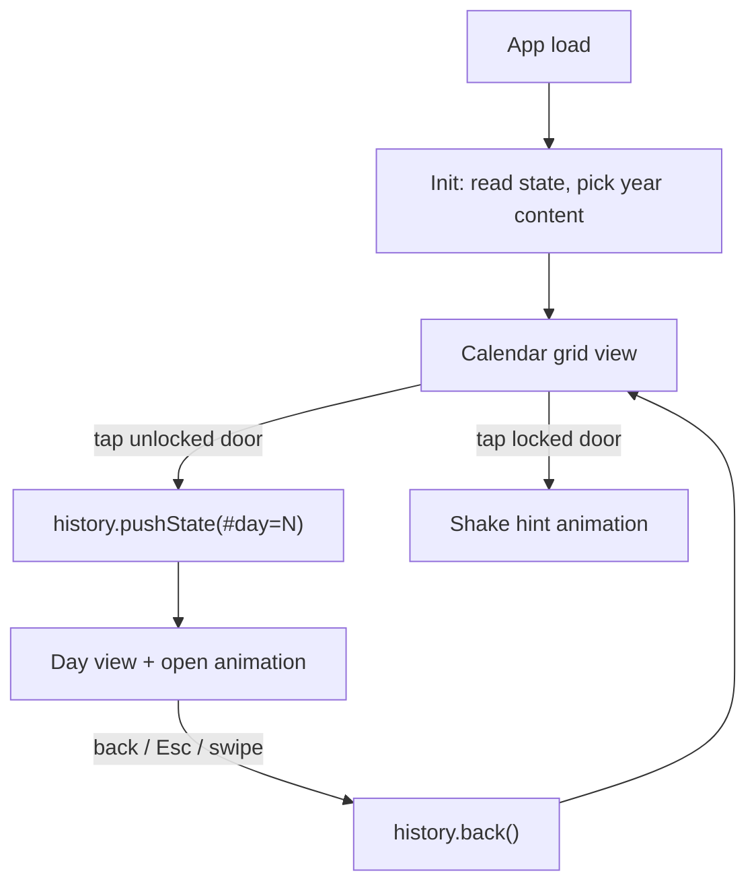

# Song Adventskalender v2 – Konzept

Full rewrite of [Song-Adventskalender v1](https://github.com/3tmp/Song-Adventskalender): a fully static, single-page advent calendar that reveals one feel-good song and a positive-lifestyle text per December day. No server, no tracking, everything on device.

## 1. Goals & non-goals

**Goals**

- 100% client-side, deployable on GitHub Pages (static hosting only).
- All state persists on the device (localStorage).
- Multi-year capable: each season gets fresh content; old content is not reused, so each year is just a new content file.
- New visual design with door-open animations.
- Faster and more robust than v1: no full page loads, no year constant to edit by hand, validated content.

**Non-goals**

- Accounts, sync across devices, or any backend.
- Serving or hosting the songs themselves (only YouTube/Spotify embeds, as before).
- Archive browsing of past years.

## 2. Tech stack

| Layer | Choice | Rationale |
| --- | --- | --- |
| Language | TypeScript | Catches content/state bugs at build time (v1's `CURRENT_YEAR` bug class) |
| Build | Vite | Dev server with HMR, minified static build output, zero-config static assets |
| UI | Vanilla TS, no framework | Two views, tiny state; whole app ships in a few kB |
| Styling | Modern CSS (custom properties, `@media (prefers-reduced-motion)`) | No CSS framework needed |
| Routing | History API (`pushState` + `popstate`) | SPA navigation that respects mobile back gestures |
| State | localStorage | On-device persistence as required |
| Tests | Vitest for logic (dates, shuffle, storage) | Cheap insurance for a once-a-year app |
| Deploy | GitHub Actions → GitHub Pages | `vite build` output pushed to Pages on every release |

**Shipped JS budget: < 15 kB gzip** including app logic and content data.

## 3. Architecture

Single page, two logical views rendered from one `index.html`:



**View transition:** door tap expands/flips the tile into the full-screen day view (CSS transform + shared-element feel). Reverse animation on back. All animations gated behind `prefers-reduced-motion`.

**Project structure**

```
src/
  main.ts            # entry: init state, render grid
  views/
    calendar.ts      # grid renderer + door states
    day.ts           # day view renderer
  core/
    router.ts        # pushState/popstate wrapper, hash deep links
    state.ts         # localStorage store (versioned schema)
    content.ts       # loads + validates year content
    unlock.ts        # date logic (which day is open today)
  content/
    2026.json        # this season's 24 entries
  styles/
    main.css
public/
  img/               # door artwork, icons, fonts (or self-hosted woff2)
```

## 4. Content model

Bundled static JSON per year, imported at build time (no runtime fetch, no first-load database copy like v1):

```json
{
  "year": 2026,
  "entries": [
    {
      "day": 1,
      "type": "song",
      "title": "Running on Air",
      "artist": "Nathan Trent",
      "quote": "…",
      "text": "…",
      "spotifyId": "1WpQu8U3quBeGnhpZn0r7N",
      "youtubeId": "SpPM1V3dqZE"
    }
  ]
}
```

- `type` stays extensible: `song` (full treatment) and `impuls` (text-only day, embeds hidden), as in v1.
- **Build-time validation**: a small script asserts exactly 24 entries, days 1–24 unique, all required fields present, and that the active year file exists. The build fails otherwise. This structurally prevents v1's "2025 constant but only 2023 data" crash.
- The active year is derived from the device date (December = current year; before/after December the season logic in §5 decides), with a tiny `config.ts` override for testing.

## 5. State management (on-device)

localStorage key `sak.state`, one versioned JSON object (v1 used ~50 scattered keys):

```json
{
  "version": 2,
  "year": 2026,
  "seed": 812394,
  "openedDays": [1, 4, 5],
  "lastVisit": "2026-12-05"
}
```

- **Seeded shuffle instead of stored songs**: on first visit of a season, a random 32-bit `seed` is generated. A seeded PRNG (e.g. mulberry32) derives a deterministic permutation of the 24 entries. The whole per-user assignment is reproducible from ~10 characters, so a partial localStorage wipe or a future migration can never silently reshuffle already-opened days (v1's `isFirstLoad` bug class).
- Migration path: unknown/older `version` → safe re-init that preserves `openedDays` where possible.
- Only this one key is written; nothing else touches storage, so "reset the calendar" is a one-key operation.

**Unlock rule:** door N is openable from December N of the season year (local device time). Outside December, the calendar shows a friendly "see you in December" teaser. A hidden dev flag (URL param, not hostname sniffing like v1) unlocks all doors for testing. Clock manipulation is accepted; this is a feel-good app, not DRM.

## 6. UX & design direction

**Calendar grid**

- Three door states: locked (dimmed), today & unopened (highlighted, gentle pulse/sparkle: the daily hook), opened (shows title + artist).
- Tap on locked → shake animation + "Abwarten und Tee trinken…"-style hint.
- Responsive grid: 2 columns on small phones up to 6–8 columns on desktop.

**Day view**

- Hero layout: large serif quote first (emotional anchor), then title/artist, then the motivational text, then embeds.
- YouTube/Spotify iframes load lazily (only when scrolled into view) so text paints instantly.
- Back affordances all funnel through `history.back()`: top-left ✕, Esc key, mobile swipe/back gesture. No separate code paths.
- "Previous day" link at the bottom to revisit opened days without returning to the grid.

**Deep links:** `#day=7` opens the day view directly on load (shareable, refresh-safe), guarded by the unlock rule.

**Visual:** warm winter palette, self-hosted fonts (woff2 subsets instead of full TTFs), per-door artwork, subtle CSS snow/particles, 3D door-flip on open. All motion disabled under `prefers-reduced-motion`.

## 7. Performance & quality

- Single HTML file, one CSS + one JS bundle, hashed assets, long-term caching.
- Fonts as woff2 subsets; images as WebP/AVIF with fallback, lazy-loaded.
- No analytics by default (optional, privacy-friendly, off by default).
- Vitest for `unlock.ts`, seeded shuffle (deterministic permutation tests), and state migration.

## 8. Deployment

- GitHub Actions workflow: on push to `main` → `npm ci && npm run build` → publish `dist/` to GitHub Pages.
- Release routine for a new season: add `content/{year}.json` (24 entries), add door artwork, tag release. No code changes required.

## 9. Migration from v1

- Fresh start for state (v1 keys are incompatible; the app treats itself as a new install).
- Reuse from v1: the content format and texts (`songs.json` 2023 entries can be ported), fonts, PWA manifest/icons, and the general unlock philosophy.
- The old repo's `img/` artwork can be carried over or replaced as part of the new design.

## 10. Open questions

1. Should there be a " December 25+" special final door (e.g. Christmas Day bonus) in addition to 24?
2. PWA install (manifest + service worker for offline) now or later?
3. Keep the "impuls" (text-only) day type in the new concept?
4. New artwork per door: reuse v1 photos, commission/illustrate new ones, or AI-generated?