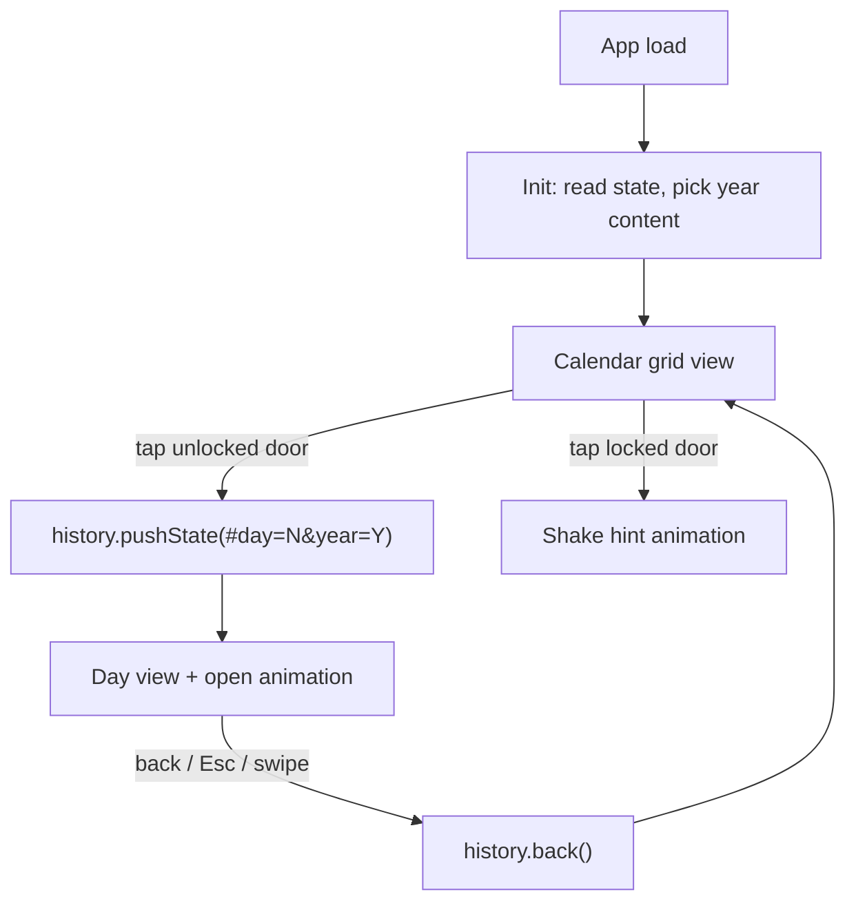

# Song Adventskalender v2 – Konzept

Full rewrite of [Song-Adventskalender v1](https://github.com/3tmp/Song-Adventskalender): a fully static, single-page advent calendar that reveals one feel-good song and a positive-lifestyle text per December day. No server, no tracking, everything on device.

## 1. Goals & non-goals

**Goals**

- 100% client-side, deployable on GitHub Pages (static hosting only).
- All state persists on the device (localStorage).
- Multi-year capable by design: content files, localStorage state, and deep links are all year-scoped. Past seasons stay in the repo and on the device, so an archive view can be added later without migration.
- Content-type extensible: a day is a generic `type` + `payload` envelope with a per-type registry, so future door types (image, text-only, …) need no changes to grid, router, state, or unlock logic.
- New visual design with door-open animations.
- Faster and more robust than v1: no full page loads, no year constant to edit by hand, validated content.

**Non-goals**

- Accounts, sync across devices, or any backend.
- Serving or hosting the songs themselves (only YouTube/Spotify embeds, as before).
- Archive browsing of past years in the v2 UI — no archive view or year picker ships. As a hidden feature instead: year-scoped deep links reach past seasons, the unlock rule lifts once a season has ended, and past content files and state keys are never auto-deleted. Nothing needs rebuilding if an archive view is added later.

## 2. Tech stack

| Layer | Choice | Rationale |
| --- | --- | --- |
| Language | TypeScript | Catches content/state bugs at build time (v1's `CURRENT_YEAR` bug class) |
| Build | Vite | Dev server with HMR, minified static build output, zero-config static assets |
| UI | Vanilla TS, no framework | Two views, tiny state; whole app ships in a few kB |
| Styling | Modern CSS (custom properties, `@media (prefers-reduced-motion)`) | No CSS framework needed |
| Routing | History API (`pushState` + `popstate`) | SPA navigation that respects mobile back gestures |
| State | localStorage | On-device persistence as required |
| Tests | Vitest for logic (dates, shuffle, storage) | Cheap insurance for a once-a-year app |
| Deploy | GitHub Actions → GitHub Pages | `vite build` output pushed to Pages on every release |

**Shipped JS budget: < 15 kB gzip** including app logic and content data.

## 3. Architecture

Single page, two logical views rendered from one `index.html`:



**View transition:** door tap expands/flips the tile into the full-screen day view (CSS transform + shared-element feel). Reverse animation on back. All animations gated behind `prefers-reduced-motion`.

**Project structure**

```
src/
  main.ts            # entry: init state, render grid
  views/
    calendar.ts      # grid renderer + door states (type-agnostic)
    day.ts           # day view shell: header, back, open animation
  core/
    router.ts        # pushState/popstate wrapper, year-scoped hash deep links
    season.ts        # active-season resolution from device date
    unlock.ts        # date logic (which day is open today)
    state.ts         # localStorage store, one key per season
    content.ts       # loads + validates the active year file
  entries/
    registry.ts      # entry-type registry: schema, renderDay, doorPreview
    song.ts          # "song" payload schema + renderer
    text.ts          # "text" payload schema + renderer
  content/
    2026.json        # one self-contained file per season
  styles/
    main.css
public/
  img/               # door artwork, icons, fonts (or self-hosted woff2)
```

## 4. Content model

The calendar is content-type-agnostic. Bundled static JSON per year, imported at build time (no runtime fetch, no first-load database copy like v1). Each day is a thin envelope: `day` + `type` are the only fixed fields, everything type-specific lives in `payload`:

```json
{
  "schemaVersion": 2,
  "year": 2026,
  "entries": [
    {
      "day": 1,
      "type": "song",
      "payload": {
        "title": "Running on Air",
        "artist": "Nathan Trent",
        "quote": "…",
        "text": "…",
        "spotifyId": "1WpQu8U3quBeGnhpZn0r7N",
        "youtubeId": "SpPM1V3dqZE"
      }
    },
    {
      "day": 5,
      "type": "text",
      "payload": { "quote": "…", "text": "…" }
    }
  ]
}
```

**Entry-type registry** (`src/entries/registry.ts`): every door type registers itself with

- `schema` — build-time payload validation (zod),
- `renderDay()` — renders the day-view body,
- `doorPreview()` — what the opened door tile shows (title + artist / caption / …),
- optional `preload()` — lazy asset handling (e.g. embed iframes).

- TypeScript discriminated union `CalendarEntry = SongEntry | TextEntry | ImageEntry | …`; an exhaustiveness check in the registry forces every renderer to handle every registered type at compile time.
- Built-in at launch: `song` (quote + text + lazy YouTube/Spotify embeds) and `text` (the rename of v1's `impuls`: quote + text only). v1's `impuls` entries map 1:1 to `text`.
- **Adding a future type** — e.g. `image` with payload `{ src, alt, caption? }` — is one new file (schema + renderer) plus one registry line. Grid, router, state, and unlock logic never change. Rendering of *unknown* payload shapes can't reach production because validation fails the build.
- **Build-time validation**: a small script asserts exactly 24 entries, days 1–24 unique, `year` matches the filename, the `schemaVersion` is one the app knows, and every payload validates against its type's schema; it also asserts that the active year file exists. The build fails otherwise. This structurally prevents v1's "2025 constant but only 2023 data" crash.
- The active season is resolved by `core/season.ts` from the device date (December = current year; before/after December the season logic in §5 decides), with a tiny `config.ts` override for testing. All past year files stay in the repo — nothing is deleted when a season ends.

## 5. State management (on-device)

one JSON object per season, stored under `sak.{year}` — `sak` stands for Song-Adventskalender and is a constant namespace prefix to avoid collisions with other data on the same origin (v1 used ~50 scattered keys):

```json
{
  "version": 2,
  "year": 2026,
  "seed": 812394,
  "openedDays": [1, 4, 5],
  "lastVisit": "2026-12-05"
}
```

- **Year-scoped state**: each season gets its own key (`sak.2026`, `sak.2027`, …). Switching years never touches another season's progress, and finished seasons' keys are never auto-deleted — kept for revisiting old calendars with zero migration.
- **Versioned state schema**: the state carries a `version` field. If a future build reads an unknown/older `version`, it falls back to a safe re-init that preserves `openedDays` where possible. The per-season key makes even a full discard cheap — only one season's progress is at risk, and only after December. v1 keys are never read: the app treats itself as a new install.
- **Seeded shuffle instead of stored songs**: on first visit of a season, a random 32-bit `seed` is generated. A seeded PRNG (e.g. mulberry32) derives a deterministic permutation of the 24 entries. The whole per-user assignment is reproducible from ~10 characters, so a partial localStorage wipe or a future migration can never silently reshuffle already-opened days (v1's `isFirstLoad` bug class). The state references entries only by `day` index — never by title/id — so the same state logic works for any content shape and any year.
- Only season keys are written; nothing else touches storage, so "reset the calendar" is a one-key operation.

**Unlock rule:** door N is openable from December N of the season year (local device time). Outside December, the calendar shows a friendly "see you in December" teaser. A hidden dev flag (URL param, not hostname sniffing like v1) unlocks all doors for testing. Clock manipulation is accepted; this is a feel-good app, not DRM.

**Past seasons:** door N of season Y is openable from December N of Y onward, so any season that has ended is fully unlocked. Combined with year-scoped deep links, revisiting old calendars is a hidden feature: `#day=7&year=2024` works forever, there is no archive UI, and old content files and state keys are never automatically deleted.

## 6. UX & design direction

**Calendar grid**

- Three door states: locked (dimmed), today & unopened (highlighted, gentle pulse/sparkle: the daily hook), opened (type-specific preview via the entry type's `doorPreview()`, e.g. title + artist).
- Tap on locked → shake animation + "Abwarten und Tee trinken…"-style hint.
- Responsive grid: 2 columns on small phones up to 6–8 columns on desktop.

**Day view**

- The day view is a type-agnostic **shell** (open animation, back affordances, deep links); the body is rendered by the entry type's `renderDay()`. The hero layout below is the `song`/`text` variant — a future `image` type plugs in without touching the shell.
- Hero layout: large serif quote first (emotional anchor), then title/artist, then the motivational text, then embeds.
- Embeds (`song` type) load lazily via the type's `preload()` (only when scrolled into view) so text paints instantly.
- Back affordances all funnel through `history.back()`: top-left ✕, Esc key, mobile swipe/back gesture. No separate code paths.
- "Previous day" link at the bottom to revisit opened days without returning to the grid.

**Deep links:** `#day=7&year=2026` opens the day view directly on load (shareable, refresh-safe), guarded by the unlock rule. The `year` param is optional and defaults to the active season — day-one year-scoping means a future archive view just reads it.

**Visual:** warm winter palette, self-hosted fonts (woff2 subsets instead of full TTFs), per-door artwork, subtle CSS snow/particles, 3D door-flip on open. All motion disabled under `prefers-reduced-motion`.

## 7. Performance & quality

- Single HTML file, one CSS + one JS bundle, hashed assets, long-term caching.
- Fonts as woff2 subsets; images as WebP/AVIF with fallback, lazy-loaded.
- No analytics by default (optional, privacy-friendly, off by default).
- Vitest for `unlock.ts` & `season.ts`, seeded shuffle (deterministic permutation tests), state-version migration, and per-type payload schemas.

## 8. Deployment

- GitHub Actions workflow: on push to `main` → `npm ci && npm run build` → publish `dist/` to GitHub Pages.
- Release routine for a new season: add `content/{year}.json` (24 entries), add door artwork, tag release. No code changes required — unless a new entry type debuts, in which case it is one registry entry + one renderer file.

## 9. Migration from v1

- Fresh start for state (v1 keys are incompatible; the app treats itself as a new install).
- Reuse from v1: the content format and texts (`songs.json` 2023 entries can be ported; `impuls` entries become the new `text` type), fonts, PWA manifest/icons, and the general unlock philosophy.
- The old repo's `img/` artwork can be carried over or replaced as part of the new design.

## 10. Open questions

1. Should there be a " December 25+" special final door (e.g. Christmas Day bonus) in addition to 24?
2. PWA install (manifest + service worker for offline) now or later?
3. Beyond `song` and `text`, which entry type ships first (e.g. `image` with `{src, alt, caption?}`)? The registry makes any of them a drop-in.
4. New artwork per door: reuse v1 photos, commission/illustrate new ones, or AI-generated?